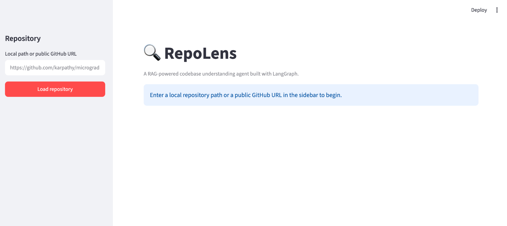
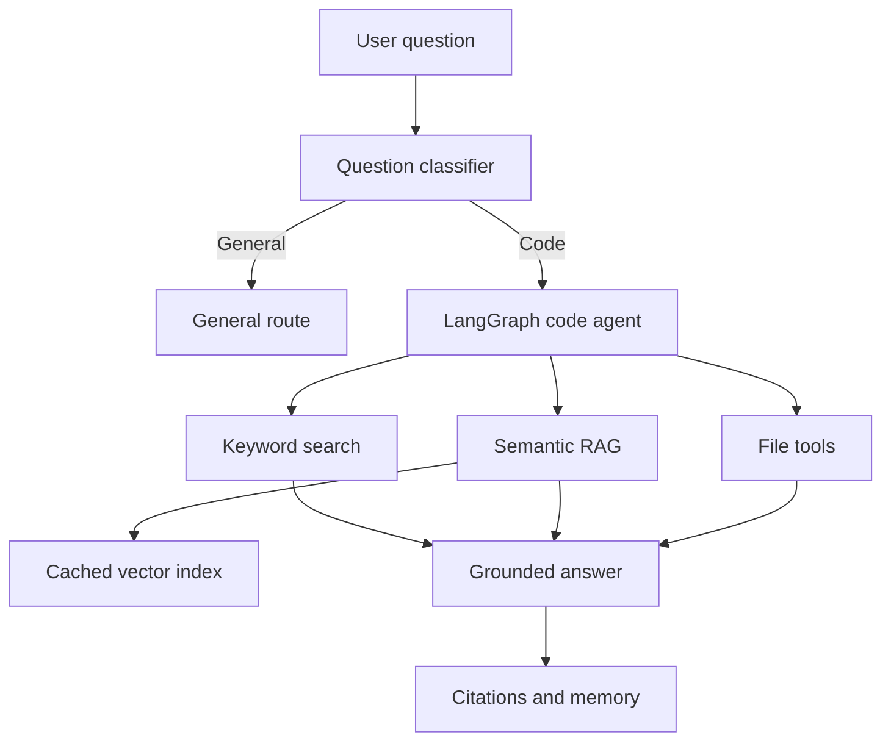

# 🔍 RepoLens

RepoLens is a RAG-powered codebase understanding agent built with LangGraph. It accepts a local repository path or a public GitHub URL, selects appropriate code-search tools, and answers repository-specific questions with file and line references.

> Portfolio project exploring agentic RAG, tool use, grounded generation, conversational memory, and automated evaluation for source-code understanding.



## Why RepoLens?

Understanding an unfamiliar repository usually requires switching between file browsing, exact symbol search, semantic search, and documentation. RepoLens combines these steps in one agent workflow and keeps its answers grounded in inspected source files.

Example questions:

- `Where is the GPT model class defined?`
- `How does run_pending decide which jobs to run?`
- `Where and how is the learning rate scheduled during training?`
- `Is user authentication implemented in this repository?`

## Features

- **Agentic tool selection** — a LangGraph agent chooses between exact keyword search, semantic search, file listing, and targeted line-range reading.
- **Hybrid retrieval** — combines identifier-based keyword search with embedding-based semantic retrieval.
- **Repository routing** — classifies whether a question requires codebase inspection or can use the general route.
- **Local and GitHub repositories** — loads an existing local directory or shallow-clones a public GitHub repository.
- **Grounded answers** — returns relevant file paths and approximate line-number citations.
- **Multi-turn memory** — keeps repository-specific conversation context using LangGraph checkpoints.
- **Persistent vector cache** — stores a separate vector index for each repository and rebuilds it only when a SHA-256 code fingerprint changes.
- **Streamlit interface** — provides repository loading, chat history, route visibility, and expandable inspected sources.
- **Automated evaluation** — measures routing, source accuracy, keyword coverage, refusal behavior, and latency across multiple repositories.

## Architecture



### Agent workflow

1. Load a local repository or clone a public GitHub repository.
2. Classify the question as `code` or `general`.
3. For code questions, let the agent select one or more retrieval tools.
4. Retrieve exact identifiers, semantically related chunks, project structure, or targeted file ranges.
5. Generate an answer using only inspected evidence.
6. Display the route and source locations in the interface.

## Retrieval tools

| Tool | Purpose |
| --- | --- |
| `keyword_code_search` | Finds exact identifiers, function names, classes, variables, and errors. |
| `semantic_code_search` | Retrieves conceptually related Python code using embeddings. |
| `list_project_files` | Inspects the repository structure and readable source files. |
| `read_project_file` | Reads a targeted line range while limiting context size. |

## Tech stack

- Python
- LangGraph
- LangChain
- OpenAI `gpt-5-nano`
- OpenAI `text-embedding-3-small`
- Streamlit
- Pydantic
- In-memory vector store with local persistence

## Project structure

```text
repolens/
├── main.py                           # Agent, graph, tools, retrieval, and repository loading
├── app.py                            # Streamlit interface
├── evaluate.py                       # Automated evaluation runner
├── evaluation_cases.json             # Evaluation dataset
├── evaluation_results_baseline_v1.json
├── requirements.txt
├── .env.example
├── .gitignore
├── assets/
│   └── repolens-ui.png
└── README.md
```

## Getting started

### 1. Clone the repository

```bash
git clone <your-repository-url>
cd repolens
```

### 2. Create and activate a virtual environment

macOS/Linux:

```bash
python3 -m venv .venv
source .venv/bin/activate
```

Windows PowerShell:

```powershell
python -m venv .venv
.venv\Scripts\Activate.ps1
```

### 3. Install dependencies

```bash
pip install -r requirements.txt
```

### 4. Configure the API key

Create a `.env` file in the project root:

```env
OPENAI_API_KEY=your_openai_api_key
```

Do not commit the `.env` file or a real API key.

### 5. Run the Streamlit application

```bash
streamlit run app.py
```

Enter either:

- an existing local repository path; or
- a public GitHub URL such as `https://github.com/karpathy/micrograd`.

### Optional: run the terminal interface

```bash
python main.py
```

## Evaluation

Run the automated evaluation suite with:

```bash
python evaluate.py
```

The current baseline contains 10 cases across `karpathy/micrograd`, `dbader/schedule`, and `karpathy/nanoGPT`.

| Metric | Baseline |
| --- | ---: |
| Overall pass rate | 80.0% |
| Routing accuracy | 90.0% |
| Source accuracy | 85.7% |
| Keyword coverage | 85.7% |
| Refusal accuracy | 50.0% |
| Average latency | 42.52 s |

These values come from one evaluation run and may vary because model routing, tool selection, and response wording are non-deterministic.

The evaluation includes:

- locating classes and functions;
- explaining implementation behavior;
- retrieving code across different repositories;
- identifying features that are not present;
- separating codebase questions from general questions.

## Example output

```text
Question: Where is the GPT model class defined?
Route: code

Answer: The GPT model class is defined in model.py as
class GPT(nn.Module), starting around line 118.

[source: model.py, lines 118-140]
```

## Known limitations

- The semantic index currently focuses on Python files.
- Only public GitHub repositories and accessible local directories are supported.
- General questions are routed away from code retrieval but currently receive a minimal response.
- Negative or missing-feature questions may produce inconsistent wording across runs.
- Tool selection and latency vary between model calls; complex questions may require several retrieval steps.
- Conversation memory and vector storage are local rather than production databases.

## Roadmap

- Enforce a hard tool-call budget and improve agent stopping conditions.
- Improve classification of short repository-dependent questions.
- Add support for more programming languages.
- Add streaming responses and richer code previews.
- Replace in-memory conversation storage with persistent sessions.
- Expand the evaluation dataset and report multi-run stability.

## Security note

RepoLens sends retrieved code context to the configured model provider. Do not use it with confidential repositories unless your data-handling requirements allow this.

## What I learned

This project provided hands-on experience with:

- designing cyclic agent workflows with LangGraph;
- combining deterministic keyword search with semantic retrieval;
- managing context size and preventing uncontrolled tool loops;
- grounding LLM answers with source evidence;
- caching and invalidating vector indexes;
- evaluating non-deterministic agent behavior with repeatable test cases.

